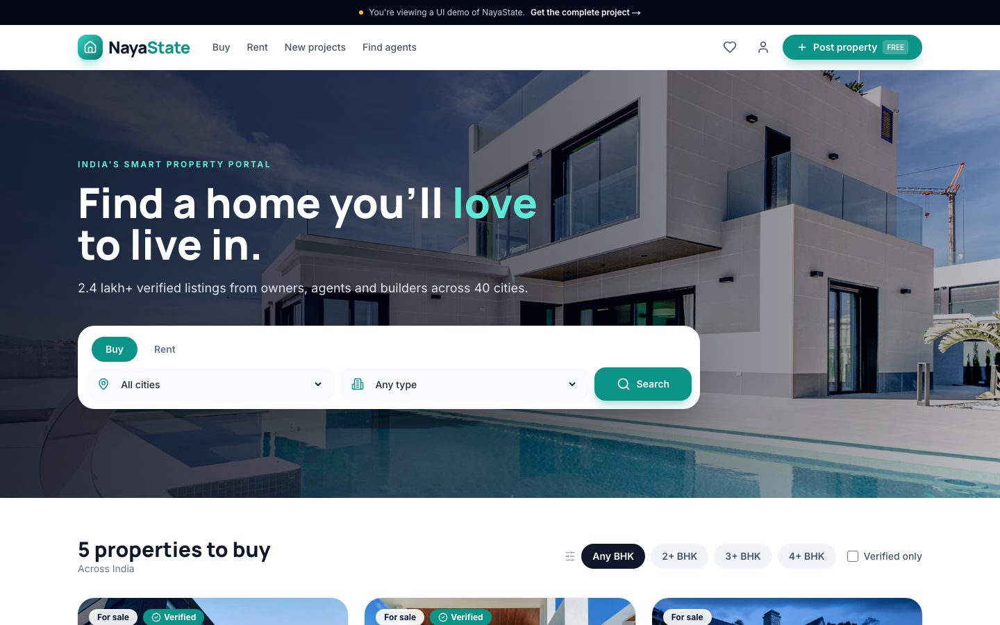
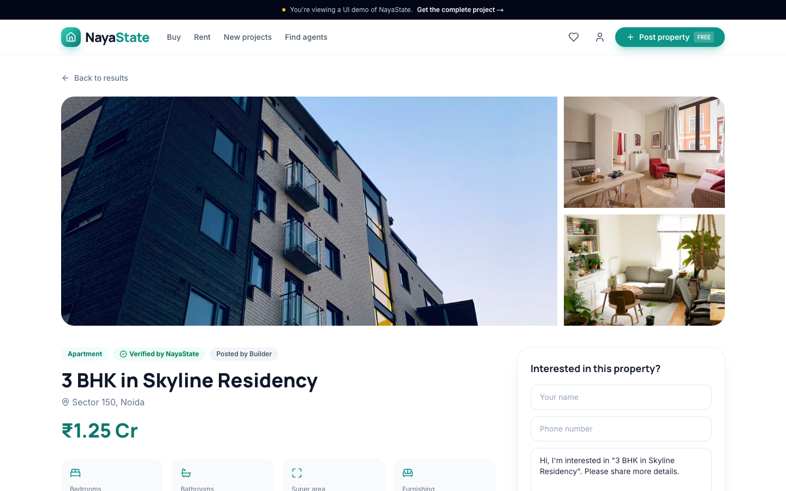
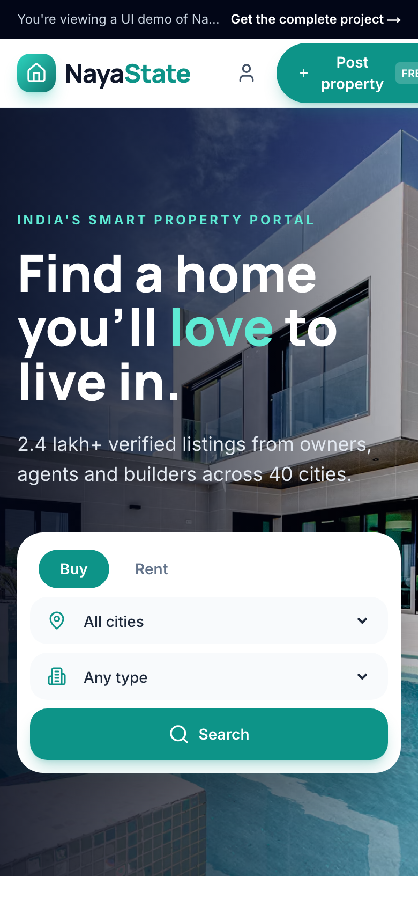

# Property Listing Platform | Real Estate Website Development

**Build Your Own Real Estate Website, Property Listing Portal, and Online Property Marketplace**

Looking for a professional **Property Listing Platform Development Company** to build your own real estate website or online property marketplace?

Naya Prayog Technologies develops custom real estate websites and property listing platforms for real estate agencies, property dealers, builders, brokers, entrepreneurs, and businesses.

Our solutions can help businesses create digital platforms where property owners, buyers, sellers, agents, and administrators can interact through organized property listing and management workflows.

Whether you want to launch a property listing website, a real estate marketplace, a property booking platform, or a customized real estate portal, we can help transform your business idea into a digital solution.

**Planning to launch your own real estate platform? Contact Naya Prayog Technologies to discuss your requirements.**

---

## What Is a Property Listing Platform?

A Property Listing Platform is a website or application that allows users to discover, publish, manage, and explore properties online.

It provides a centralized digital environment where buyers, sellers, property owners, agents, and real estate businesses can connect.

A modern property listing portal may support:

- Residential property listings
- Commercial property listings
- Properties for sale
- Properties for rent
- Property owner and seller accounts
- Real estate agent profiles
- Property search and filters
- Property enquiries
- Property booking workflows
- Administrative management

The exact capabilities depend on the selected business model and implementation scope.

## Real Estate Website and Property Portal Development Services

Naya Prayog Technologies can develop customized property listing websites and real estate applications based on your business requirements.

### 1. Property Listing Management

Organize property information and publish property listings through a centralized platform.

Potential capabilities include:

- Add new property listings
- Edit property information
- Upload property photographs
- Manage property descriptions
- Add property locations
- Manage property categories
- Publish and update listings
- Manage listing status

### 2. Property Search and Discovery

Help visitors discover relevant properties through convenient search experiences.

Potential capabilities include:

- Search properties
- Filter by property type
- Filter by location
- Filter by budget
- Filter by sale or rental category
- Property detail pages
- Property image galleries
- Location-based discovery

### 3. Buyer and Seller Management

Build separate user experiences for people interested in buying or selling properties.

Potential capabilities include:

- User registration and authentication
- Buyer profiles
- Seller profiles
- Property owner accounts
- Manage submitted listings
- Property enquiry management
- User account management

### 4. Real Estate Agent Management

Support real estate agencies and agents through organized account and listing workflows.

Potential capabilities include:

- Agent registration
- Agent profiles
- Property assignment
- Agent listing management
- Customer enquiry management
- Agent information pages

### 5. Property Enquiry Management

Help potential buyers and tenants contact property owners or agents.

Potential capabilities include:

- Property enquiry forms
- Buyer contact details
- Seller contact workflows
- Enquiry management
- Lead tracking
- Enquiry notifications

### 6. Property Booking and Reservation

Develop property booking or reservation workflows according to your business model.

Potential capabilities include:

- Property booking requests
- Visit scheduling
- Reservation workflows
- Booking status management
- Booking administration

### 7. Payment and Monetization

Support business-specific revenue models through optional payment and subscription functionality.

Potential capabilities include:

- Paid property listings
- Seller subscription plans
- Featured property promotions
- Booking payments
- Online payment gateway integration
- Commission-based business models

The final payment workflow and applicable commercial terms depend on the agreed requirements and payment provider.

### 8. Admin Dashboard

A centralized administration portal can be developed to manage the real estate platform.

Potential capabilities include:

- User management
- Buyer and seller management
- Property listing administration
- Agent management
- Property approval workflows
- Enquiry management
- Booking management
- Subscription administration
- Platform configuration
- Administrative reporting

*Note: These are potential capabilities for custom real estate platform development. They should not be interpreted as confirmation that every feature is already implemented in a ready-to-deploy product.*

---

## Types of Property Listing Platforms We Can Develop

### Residential Property Listing Website

Platforms for apartments, houses, villas, plots, and other residential properties.

### Commercial Property Listing Portal

Websites for offices, shops, commercial buildings, warehouses, and business spaces.

### Real Estate Marketplace

Multi-user platforms where property owners, agents, and buyers interact through property listings and enquiry workflows.

### Property Rental Platform

Applications for property owners and tenants to discover and manage rental properties.

### Real Estate Agency Website

Professional websites for real estate agencies to showcase property inventories and generate enquiries.

### Property Booking Platform

Customized solutions for property reservations, booking requests, and related payment workflows.

### Real Estate Classified Website

Platforms that allow users to publish and discover property advertisements.

---

## NayaState – Real Estate Platform Concept

**NayaState** is a real estate platform concept within the Naya Prayog Technologies product portfolio.

It represents our work toward digital property discovery and real estate business workflows.

The platform concept focuses on connecting property-related users through online listings and structured property management experiences.

For current development status, available functionality, product demonstrations, or commercial opportunities, contact Naya Prayog Technologies.

Website: https://nayaprayog.com/nayastate/

---

## Who Needs a Property Listing Platform?

Our real estate development services can support:

- Real estate startups
- Property dealers and brokers
- Real estate agencies
- Property consultants
- Builders and developers
- Property owners
- Commercial real estate businesses
- Rental property businesses
- Entrepreneurs launching real estate marketplaces
- Businesses planning online property portals

## Business Benefits of a Property Listing Website

**Expand Your Digital Reach**

Present property inventories online and make property information accessible to prospective buyers and tenants.

**Organize Property Information**

Maintain structured property listings, photographs, descriptions, and location information.

**Generate Property Enquiries**

Provide visitors with convenient ways to contact property owners, agents, or real estate businesses.

**Support Multiple User Types**

Design separate experiences for buyers, sellers, agents, and administrators.

**Build Your Own Real Estate Brand**

Launch a customized property portal under your business identity.

**Create New Revenue Opportunities**

Explore listing subscriptions, featured properties, booking charges, and other business models where appropriate.

---

## Technology and Development Capabilities

Depending on your requirements, our real estate platform development projects can use modern web and backend technologies.

| Technology | Development Area |
|---|---|
| React / Next.js | Real estate websites and web applications |
| Flutter | Cross-platform mobile applications |
| Python / FastAPI | Backend and API development |
| Node.js | Backend services |
| PostgreSQL | Relational database management |
| MongoDB | Document-oriented database solutions |
| Firebase | Authentication and related services |

The final technology stack depends on platform requirements, performance expectations, scalability, integrations, and infrastructure.

## Real Estate Website Development Process

1. **Requirement Analysis:** Understand your real estate business model and target audience.
2. **Platform Planning:** Define user roles, listing workflows, and required modules.
3. **UI/UX Design:** Design an intuitive property discovery experience.
4. **Development:** Build the website, backend, APIs, and administrative dashboard.
5. **Testing:** Validate property workflows, user experiences, and platform functionality.
6. **Deployment:** Prepare the agreed solution for production.
7. **Maintenance:** Plan future enhancements and technical support.

---

## Why Choose Naya Prayog Technologies?

Naya Prayog Technologies develops custom software products and digital solutions for businesses.

Our development capabilities include:

- Real Estate Website Development
- Property Listing Platform Development
- Real Estate Marketplace Development
- Custom Web Application Development
- Mobile App Development
- Backend and API Development
- Admin Dashboard Development
- Payment Gateway Integration
- SaaS Application Development
- Business Automation Solutions

We help businesses turn their ideas into practical digital products through technology and custom software development.

Website: https://nayaprayog.com/

---

## Frequently Asked Questions

### How much does property listing website development cost?

The cost depends on the number of modules, user roles, property listing workflows, design requirements, integrations, payment functionality, and development scope. Contact us for a customized project estimate.

### Can you develop a website similar to popular real estate portals?

Yes. We can develop an original real estate website inspired by common property marketplace workflows, with customized branding, design, and functionality.

### Can property owners list their own properties?

Owner-submitted property listings can be included as part of the agreed platform requirements.

### Can I create a multi-vendor real estate marketplace?

Yes. We can discuss a multi-user marketplace where property owners, agents, and other authorized users can manage listings.

### Can you integrate property booking and online payments?

Booking and payment functionality can be developed according to your business model, technical requirements, and payment provider policies.

### Can the website be customized for my real estate business?

Yes. We can customize the platform's branding, workflows, property categories, user roles, and additional modules.

### Can you also develop a mobile application?

Yes. Android and iOS applications can be included as part of a broader real estate platform development project.

---

## Start Your Real Estate Website Development Project

**Ready to build your own property listing website or real estate marketplace?**

Let's discuss your business requirements and develop a digital platform around your real estate business model.

### Contact Naya Prayog Technologies

- **Website:** https://nayaprayog.com/
- **NayaState:** https://nayaprayog.com/nayastate/
- **Email:** support@nayaprayog.com
- **Phone / WhatsApp:** +91 7991327022
- **WhatsApp Enquiry:** https://wa.me/917991327022
- **Portfolio:** https://github.helloharendra.io

**Contact us for a consultation, product discussion, or custom real estate software development proposal.**

---

## Related Development Services

Explore other software development solutions:

- Real Estate Management Software
- Real Estate Website Development
- Multi-Vendor Marketplace Development
- E-commerce Website Development
- Custom Web Application Development
- Mobile App Development
- SaaS Application Development
- CRM Software Development
- Business Management Software

Visit https://nayaprayog.com/ to explore our software products and development services.

---

## Developed By

**Naya Prayog Technologies**

Custom Software Development | Web Applications | Mobile Applications | Digital Business Solutions

Website: https://nayaprayog.com/

© Naya Prayog Technologies. All rights reserved.

This repository is a product and service showcase. It does not distribute proprietary application source code or grant an open-source license.

<!-- screenshots -->
## Screenshots

**Home**

**Property Details**

<table>
  <tr>
    <td align="center" width="260"><b>Mobile View</b>  </td>
  </tr>
</table>
